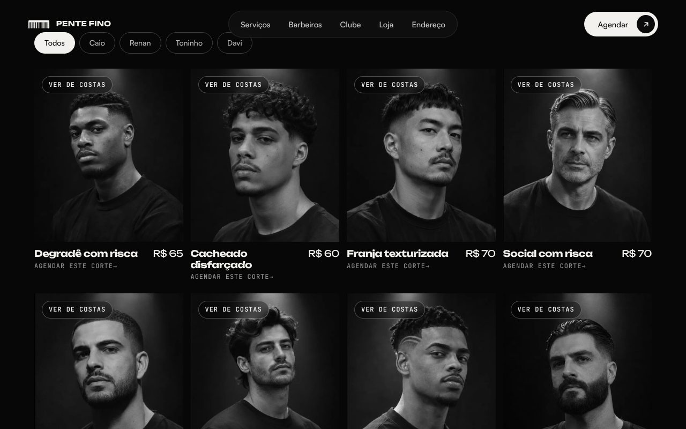

<h1 align="center">👋 Hi, I'm Eduardo Torres</h1>
<h3 align="center">Data Analyst | SaaS Builder | AI Applied to Real Problems</h3>

---

<h2>👨🏻‍💻 About Me</h2>

• Data Analyst focused on automation and decision intelligence  
• Builder of SaaS products and web apps with AI integration  
• I build websites for local businesses in Sorocaba/SP — from briefing to launch  
• Strong background in Python, SQL and backend architecture  

🌐 **Portfolio:** [eduardotorres-dev.com.br](https://eduardotorres-dev.com.br) — all projects, live demos and how I work.

Currently building intelligent systems that combine:
Data + Automation + LLMs + Real-world business use cases

---

<h2>🚀 Featured Projects</h2>

<table>
<tr>
<td width="50%" valign="top">

<b><a href="https://github.com/EduardoTorres92/fit-ai">FIT.AI</a></b> 
Calisthenics training app with a real AI Coach (Claude) that reads the user's own history. Progression tracking, Strava integration, serverless backend with rate limits.  
<a href="https://fitai-eduardo.netlify.app">▶ Live demo</a> · JavaScript · Netlify Functions · Claude API
</td>
<td width="50%" valign="top">

<b><a href="https://github.com/EduardoTorres92/banho-e-tosa-sol">Banho e Tosa Sol</a></b> 
Cinematic scroll-driven website for a real pet grooming business: AI-generated video sliced into frames on a canvas, WhatsApp booking and contact form.  
<a href="https://banhoetosasol.netlify.app">▶ Live site</a> · HTML/CSS/JS · Canvas · Netlify
</td>
</tr>
<tr>
<td colspan="2" valign="top">

<b><a href="https://github.com/EduardoTorres92/modelo-site-advocacia">Law Firm Website Template</a></b> 
Resellable website for Brazilian law firms, in black and white with film grain: a looping video hero, practice areas pinned to the scroll, a contract that gets redlined as you scroll until both signatures draw in, and a case-tracking tool on top of CNJ's public DataJud API that explains each court update in plain Portuguese. Serverless function with retries and CDN caching to survive a slow public API. Built within the bar association's advertising rules (OAB Provimento 205/2021).  
<a href="https://advocacia-modelo-eduardo.vercel.app">▶ Live demo</a> · JavaScript · GSAP · Lenis · Vercel Functions · DataJud API  
  
</td>
</tr>
<tr>
<td colspan="2" valign="top">

<b><a href="https://github.com/EduardoTorres92/barbeari-ia/tree/main/landing">Barbershop Landing Page · Pente Fino</a></b> 
Black-and-white landing page for a barbershop with a real-time 3D barber chair (Three.js) under a spotlight, a cinematic intro where a comb passes through hair, a numbered price list where the matching tool follows the cursor, barbers' mirrors that light up on selection, before/after haircut cards and a membership club. Every booking button opens WhatsApp with a pre-filled message (naming the service when there is one). Deployed as a static build on a Hostinger subdomain.  
<a href="https://barbearia.eduardotorres-dev.com.br">▶ Live demo</a> · JavaScript · Three.js · GSAP · Lenis · Vite · Hostinger  
  
</td>
</tr>
<tr>
<td colspan="2" valign="top">

<b><a href="https://github.com/EduardoTorres92/dash_vendas">Sales Dashboard</a></b> 
Interactive revenue analysis for a multi-unit business: net revenue per business unit (gross + cut-off − returns) with month-over-month variation, ETL pipelines for billing, returns and shipments, shipment potential, lead time and a Brazil map. Real reports can be uploaded locally; a demo mode runs on fictional data, and the repo blocks real spreadsheets from ever being committed.  
Python · Streamlit · Pandas · Plotly  
  
</td>
</tr>

</table>

🔹 **Data Pipelines & ETL Projects**  
Python + SQL pipelines, API integrations (Correios, Qive, CRMs), structured data transformation.

---

<h2>🛠 Tech Stack</h2>

<h3>📊 Data & Analytics</h3>

<h3>⚙️ Backend & Infrastructure</h3>

<h3>🌐 Web</h3>

<h3>🧠 AI & Automation</h3>

• RAG architectures  
• AI agents with tool calling (Claude, OpenAI)  
• LLM integrations  
• Workflow automation  
• API integrations  

---

<h2>🎯 What You’ll Find Here</h2>

• Real business-driven systems  
• Practical AI applications  
• Data pipelines that actually run in production  
• SaaS experiments evolving into products  

Building things that solve problems — not just tutorials.
